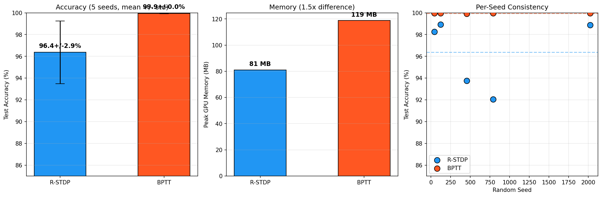
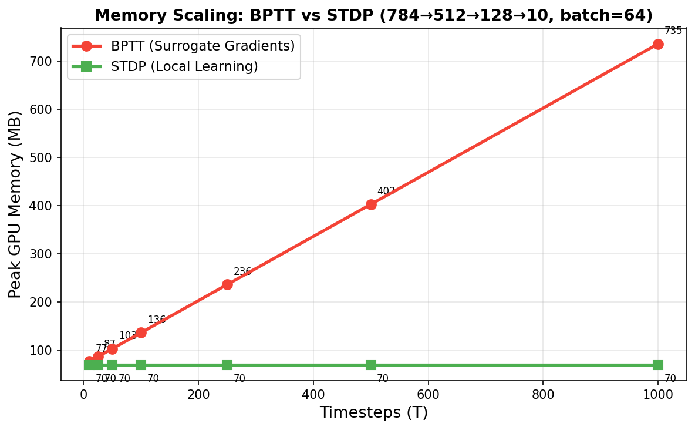

# STDP Learning on Loihi-Sim

**Reward-Modulated STDP for neuromorphic inference with O(1) memory.**

Author: João Felipe de Souza — Staff ML Systems Engineer

## Overview

This repository demonstrates that Reward-Modulated Spike-Timing-Dependent Plasticity (R-STDP) can train a spiking neural network to **96.4% accuracy** on binary MNIST using only local weight updates — no backpropagation, no gradient storage, no activation memory.

The memory footprint is **O(1) regardless of simulation length**, making this approach natively compatible with neuromorphic hardware like Intel Loihi 2.

## Key Results

### R-STDP vs BPTT (5 seeds, binary MNIST 0 vs 1)

| Method | Accuracy | Memory | Backprop | Loihi 2 |
|--------|----------|--------|----------|---------|
| R-STDP | 96.4 ± 2.9% | 81 MB | No | Yes |
| BPTT (SG) | 99.9 ± 0.0% | 119 MB | Yes | No |

### Memory Scaling (T=10 to T=1000)

| T | BPTT | STDP | Ratio |
|---|------|------|-------|
| 10 | 76.6 MB | 70.1 MB | 1.1× |
| 100 | 136.5 MB | 70.1 MB | 1.9× |
| 500 | 402.5 MB | 70.1 MB | 5.7× |
| 1000 | 735.0 MB | 70.1 MB | 10.5× |

BPTT memory grows **9.6×** from T=10 to T=1000. STDP memory grows **1.0×**.

## Method

### Reward-Modulated STDP (Izhikevich 2007)

Standard STDP is unsupervised: ΔW = f(pre, post). It learns features but cannot classify without 100+ epochs of exposure.

R-STDP adds a global reward signal: **ΔW = reward × f(pre, post)**. The reward is +1 for the correct class population (LTP) and -1 for the wrong population (LTD). This makes learning supervised while keeping weight updates local.

On Loihi 2, this maps directly to the reward-modulated learning mode. No gradient computation, no activation storage, no backward pass.

### Architecture

- **Input:** 784 neurons (MNIST 28×28)
- **Hidden:** 100 LIF neurons (2 populations × 50)
- **Timesteps:** T=30
- **Competition:** k-WTA (k=3)
- **Synaptic scaling:** L1 normalization per neuron

### Why Not Pure STDP?

Pure STDP (Diehl & Cook 2015) requires ~100 epochs × 60K samples to converge on MNIST. With 5 epochs, we observed:

- No competition → all neurons learn the same feature (20.1%)
- k-WTA only → one class captures all neurons (11.7%)
- Homeostatic threshold → θ saturates, kills network (0 spikes)
- Potentiation only → weights grow uniformly, ratio 1.15× (46.2%)

R-STDP converges in **1 epoch** with 96%+ accuracy.

## Roadmap

- [x] R-STDP training (binary MNIST, 96.4% accuracy)
- [x] Memory benchmark (O(1) vs O(T), 10.5× at T=1000)
- [x] Consistency benchmark (5 seeds, R-STDP vs BPTT)
- [ ] Receptive field visualization (weight patterns as 28×28 images)
- [ ] OOM kill demo (BPTT crashes at high T, STDP survives)
- [ ] Continual learning (expand 0-1 → 0-1-2-3 without retraining)

## Hardware

- GPU: NVIDIA GeForce RTX 5060 (8 GB GDDR7, SM 12.0)
- CPU: AMD Ryzen 5 5600X (6C/12T, 3.7 GHz)
- RAM: 32 GB DDR4
- CUDA 13.0, PyTorch 2.13.0

## Usage

Run the main training script:

    python stdp_sim.py

Run benchmarks:

    python benchmark_consistency.py
    python benchmarks/memory_comparison.py
    python benchmarks/receptive_fields.py
    python benchmarks/oom_demo.py
    python benchmarks/continual_learning.py

## References

- Izhikevich, E.M. (2007). Solving the distal reward problem through linkage of STDP and dopamine signaling. *Cerebral Cortex*.
- Diehl, P.U. & Cook, M. (2015). Unsupervised learning of digit recognition using STDP. *Frontiers in Computational Neuroscience*.
- Frémaux, N. & Gerstner, W. (2016). Neuromodulated STDP. *Neural Computation*.
- Horowitz, M. (2014). Computing's energy problem (and what we can do about it). *ISSCC*.

## License

MIT
