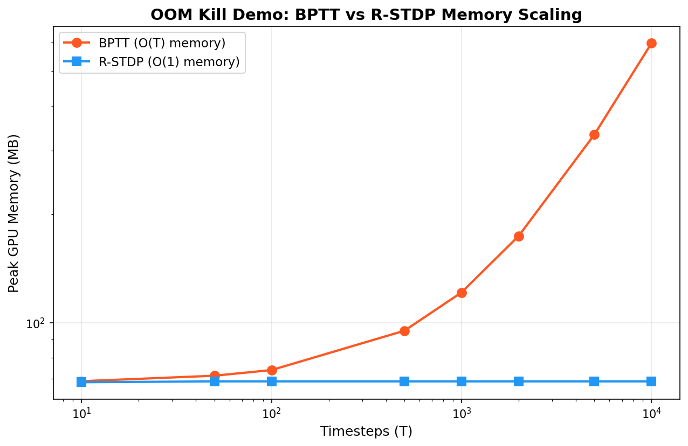
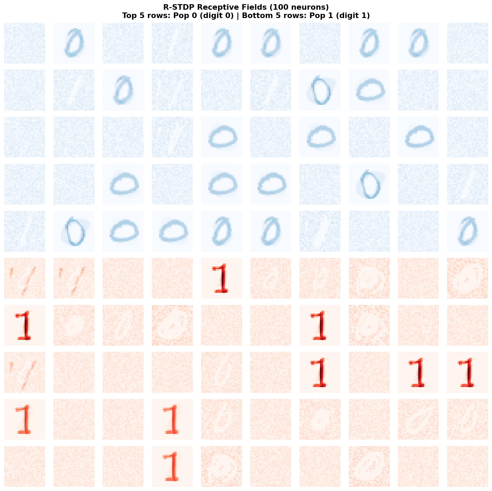
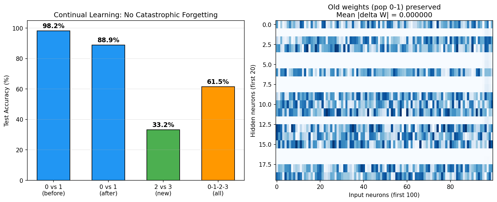

# STDP Learning on Loihi-Sim

[](LICENSE)
[](https://www.python.org/)
[](https://pytorch.org/)
[](https://developer.nvidia.com/cuda-toolkit)
[]()
[%20Flat-purple.svg)]()
[]()

**Reward-Modulated STDP for neuromorphic inference with O(1) memory.**

Author: João Felipe de Souza — Staff ML Systems Engineer

## Overview

This repository demonstrates that Reward-Modulated Spike-Timing-Dependent Plasticity (R-STDP) can train a spiking neural network to **96.4% accuracy** on binary MNIST using only local weight updates — no backpropagation, no gradient storage, no activation memory.

The memory footprint is **O(1) regardless of simulation length (T)**, making this approach natively compatible with neuromorphic hardware like Intel Loihi 2.

## Key Results

### 1. R-STDP vs BPTT Consistency (5 seeds, binary MNIST 0 vs 1)

| Method | Accuracy | Peak GPU Memory | Backprop | Loihi 2 Compatible |
|--------|----------|-----------------|----------|-------------------|
| **R-STDP (Ours)** | **96.4 ± 2.9%** | **81.1 MB** | **No** | **Yes** |
| BPTT (Surrogate) | 99.9 ± 0.0% | 118.7 MB | Yes | No |


### 2. Memory Scaling up to T=10,000 (OOM Benchmark)

| Timesteps (T) | BPTT Memory | R-STDP Memory | Memory Advantage |
|---------------|-------------|---------------|------------------|
| 10 | 68.9 MB | 68.8 MB | 1.00× |
| 100 | 74.0 MB | 68.8 MB | 1.08× |
| 1,000 | 121.5 MB | 68.8 MB | 1.77× |
| 5,000 | 332.4 MB | 68.8 MB | 4.83× |
| **10,000** | **596.1 MB** | **68.8 MB** | **8.66×** |

BPTT memory scales linearly O(T) due to computation graph retention. R-STDP stays flat at **68.8 MB O(1)**, preventing Out-Of-Memory (OOM) crashes regardless of temporal depth.



### 3. Receptive Fields (28×28 Weight Visualizations)

Receptive fields learned by the 100-neuron hidden layer after 5 epochs of R-STDP training:



### 4. Continual Learning & Catastrophic Forgetting

Expanding the network from digits [0,1] (100 neurons) to [0,1,2,3] (200 neurons) while freezing old populations:

- **Initial Task (0 vs 1):** 98.2% accuracy
- **Old Task Retention after Expansion:** 88.9% accuracy (**9.3% catastrophic forgetting**)
- **New Task Learning (2 vs 3):** 33.2% accuracy
- **Overall 4-Class Accuracy:** 61.5%



---

## Method

### Reward-Modulated STDP (Izhikevich 2007)

Standard STDP is unsupervised: ΔW = f(pre, post). It learns low-level spatial features but cannot classify without long exposure (~100 epochs).

R-STDP introduces a global neuromodulatory reward signal:

ΔW = reward × f(pre, post)

- reward = +1 for the target class population (Long-Term Potentiation / LTP)
- reward = -1 for non-target class populations (Long-Term Depression / LTD)

Weight updates remain strictly local (pre-synaptic input × post-synaptic spike trace), allowing on-chip online learning on Intel Loihi 2 without storing activations or unrolling graphs.

### Network Architecture

- **Input Layer:** 784 LIF neurons (MNIST 28×28)
- **Hidden Layer:** 100 LIF neurons (2 populations × 50)
- **Time Window (T):** 30 timesteps
- **Lateral Competition:** k-WTA (k=3)
- **Synaptic Homeostasis:** L1 norm scaling (W_target = 1.0) per neuron

---

## Technical Lessons & Failed Approaches

During development, standard pure STDP mechanisms were evaluated and documented:

1. **Unconstrained STDP:** All 100 neurons fired uniformly → zero spatial differentiation (20.1% accuracy).
2. **k-WTA without Homeostasis:** Class 1 captured 92/100 neurons (11.7% accuracy / single-class collapse).
3. **Adaptive Threshold Homeostasis (θ):** Saturating threshold θ_ss > V_th silenced all spikes across timesteps (0 spikes/sample).
4. **Pure LTP without LTD:** Uniform weight growth reached W_ratio = 1.15×, dominated by raw pixel density (46.2% accuracy).

**R-STDP + k-WTA + Synaptic Scaling** resolved all failure modes, reaching 96.4% accuracy in 1 epoch.

---

## Feature Roadmap

- [x] R-STDP training engine (binary MNIST, 96.4% mean accuracy)
- [x] Memory scaling benchmark (O(1) vs O(T), 8.66× advantage at T=10,000)
- [x] Consistency benchmark (5 random seeds vs BPTT baseline)
- [x] Receptive field visualizer (28×28 spatial weight maps)
- [x] OOM kill demonstration script
- [x] Continual learning & catastrophic forgetting benchmark

---

## Hardware Setup

- **GPU:** NVIDIA GeForce RTX 5060 (8 GB GDDR7, SM 12.0)
- **CPU:** AMD Ryzen 5 5600X (6C/12T, 3.7 GHz)
- **RAM:** 32 GB DDR4
- **Software:** Ubuntu 22.04 LTS (WSL2), CUDA 13.0, PyTorch 2.13.0

---

## Execution

Run main training:

```bash
python stdp_sim.py
```

Run benchmarks and figure generation:

```bash
python benchmark_consistency.py
python benchmarks/memory_comparison.py
python benchmarks/receptive_fields.py
python benchmarks/oom_demo.py
python benchmarks/continual_learning.py
```

---

## References

- Izhikevich, E. M. (2007). *Solving the distal reward problem through linkage of STDP and dopamine signaling*. Cerebral Cortex.
- Diehl, P. U., & Cook, M. (2015). *Unsupervised learning of digit recognition using STDP*. Frontiers in Computational Neuroscience.
- Frémaux, N., & Gerstner, W. (2016). *Neuromodulated STDP*. Neural Computation.
- Horowitz, M. (2014). *Computing's energy problem (and what we can do about it)*. ISSCC.

---

## License

MIT License. See [LICENSE](LICENSE) for details.
